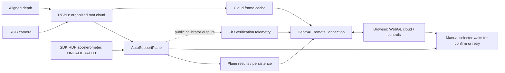

# Auto support plane — OAK4 standalone showcase

Choose a support surface in a browser, confirm it, and watch the point cloud against
that plane. In continuous mode, depth/gravity checks detect a plane that no longer
matches the scene and return you to candidate selection.

The app uses the actual `AutoSupportPlane` from **PR #340**, pinned to commit
`299bd64e9790bd985583c91c2d0846b02124281e`. Install this folder's requirements so
the standalone container and host runner use that reproducible revision while
the node is unreleased. Library code is not copied or modified by this example.

## Run on an OAK4

Requires an OAK4 with RGB camera, calibrated depth, and an accelerometer. The camera
needs internet access for the first dependency/container build. The installed app
and browser assets work without internet afterward; no model or CDN is used.

The container installs Open3D's native runtime libraries (`libgfortran5`, `libgomp1`,
`libegl1`, `libgl1`) and checks shared-library resolution plus native imports during
the build. EGL/GL dependencies follow the [Open3D Docker guidance](https://www.open3d.org/docs/latest/docker.html).

From this example directory:

```sh
oakctl device list
oakctl app run . -d <OAK4-IP>
```

Open `http://<OAK4-IP>:8082`. The app serves its own local HTTP frontend; it also opens
native DepthAI RemoteConnection on port **8765**. Access is intended for your
trusted local network. The app does not add authentication or TLS.

The OAK base image also serves the static frontend over its assigned HTTPS port
and proxies `/dai` to RemoteConnection. That assigned port belongs to nginx, so
the app's Python HTTP server deliberately uses a separate port. The browser
supports both paths; the direct HTTP URL avoids a self-signed-certificate setup.

`app run` replaces the device's development app (ID `000…`). To keep an existing
development app, build and install this showcase separately instead:

```sh
mkdir -p artifacts
oakctl app build . -d <OAK4-IP> --output ./artifacts
oakctl app install ./artifacts/<package>.oakapp -d <OAK4-IP> \
  --keep-others --enable false
oakctl app list -d <OAK4-IP>
```

Use the package filename printed by `build`. Installation starts the app but the
command above does not enable automatic startup or disable other installed apps.
Only one camera-using app should run at a time. Stop this app with
`oakctl app stop <app-id> -d <OAK4-IP>`.

## Try it

1. Point the camera down toward a table or floor and hold it still. Two visible
   horizontal surfaces at different heights make candidate switching easiest.
1. Click a candidate. Points within the configured check distance are **amber**.
   The fitted cloud is frozen, so all candidates are compared against the same
   source frame. Orbit by dragging, zoom by scrolling, or pan with Shift-drag.
1. Click **Confirm plane**. The cloud becomes live and matching points turn
   **green**. The app shows coverage, tilt, and the last result's `passed` value.
1. Move the camera enough to change the plane's offset/orientation or coverage.
   After the configured number of failed checks, a refit opens new candidates.
   The previous plane remains held until a replacement is confirmed.
1. Try **None of these · retry**. This returns `None` from the custom selector;
   the node starts another attempt and sends no successful result for that fit.

Motion preserving the same support plane equation can still pass verification;
the node checks the plane, not camera motion itself. Occlusion can also reject a
check. A failed refit retains the old plane and reports `passed=False` with that
plane, then continuous checks resume. The last output's `passed=True` can remain
visible while a later check fails: ordinary rejected checks do not emit a new
`AutoSupportPlaneResult`. Use the separate **Last check** indicator.

## Features covered

| Node capability                               | Where to try it                                                                                                        |
| --------------------------------------------- | ---------------------------------------------------------------------------------------------------------------------- |
| Custom `selectCandidate`                      | Default manual candidate preview and confirmation                                                                      |
| Reject all candidates (`None`)                | **None of these · retry**                                                                                              |
| Default ranking                               | Run settings → **Automatic**: most inliers, nearest plane on ties; no selector is passed                               |
| `ON_START`                                    | Finds once; no periodic checks; a capped failed attempt waits for **Search again**                                     |
| `CONTINUOUS`                                  | Default: periodic checks, failure streak, refit; retries failed attempts when no plane exists                          |
| `check_interval_sec`                          | Run settings → check interval                                                                                          |
| `failed_checks_before_refit`                  | Run settings → failures before refit                                                                                   |
| `initialPlane` verification gate              | Saved plane → **Restore JSON**; accepted planes are held without fitting, rejected ones are dropped and searched again |
| Persistence                                   | Confirmed planes are saved on the OAK and restored/verified on the next app start                                      |
| SupportPlane JSON                             | **Export JSON**, **Restore JSON**, **Forget**; the file contains only `normal` and `offset_mm`                         |
| Candidate `inlier_count` / `inlier_ratio`     | Candidate cards; measured on the downsampled/filtered fitting cloud                                                    |
| Verification `on_plane_ratio` / gravity angle | Coverage/tilt panel; measured on the current sampled valid depth cloud                                                 |
| `max_calibration_attempts`                    | Attempt limit is a number of fitted clouds, **not** Start commands; blank = uncapped                                   |
| Independent check/fitting thresholds          | Check distance / minimum coverage versus advanced RANSAC band / minimum inliers                                        |
| All other fitting parameters                  | Advanced fitting: sample points, iterations, passes, voxel size, tilt limit, merge distance                            |
| Result protocol and failure behavior          | Last `passed` value, retained plane JSON, activity, last calibration outcome                                           |
| Fresh IMU requirement                         | Sensor warning after 0.5 s without accelerometer data; fitting and checks wait                                         |

Configuration is immutable at build. **Apply & restart search** reconstructs the
pipeline with validated settings. **Search again** explicitly starts fresh;
**Restore JSON** reconstructs it with `initialPlane`. These are app controls, not
an undocumented runtime configuration API on the node.

DepthAI 3.12 closes its devices when a pipeline stops; each app rebuild opens a
fresh device handle. The browser server and RemoteConnection stay alive throughout.

Verification samples every fourth row and column and needs at least **500 valid
sampled points**. Below that it reports an unmeasured ratio and rejects the check.
The full 320×200 cloud can supply 4,000 samples. The browser's display stride of 2
does not affect calibration or verification. Highlighting uses the check-distance
band; highlighted points are not the fitter's exact RANSAC inlier indices.

## Host run

Use an isolated environment from **this folder** (Python 3.11/3.12 recommended):

```sh
python3 -m venv .venv
. .venv/bin/activate
python -m pip install -r requirements.txt
oakctl run-script .venv/bin/python main.py --device <OAK4-IP>
```

Open `http://localhost:8082`. This runs Python on the computer and uses the camera
in peripheral mode; the standalone commands above run Python on the OAK.
`--initial-plane file.json` restores a specific file; `--no-restore` starts without
the previously saved plane. `--port`, `--ws-port`, `--bind`, and `--fps` are also
available. Device storage uses `OAKAGENT_STORAGE_APP/support_plane.json`; host
storage defaults to this folder's ignored `storage/` directory.

## Offline MRE and tests

The optional synthetic runner exercises **real AutoSupportPlane + Open3D + native
DepthAI queues/services** with generated cloud/IMU data:

```sh
.venv/bin/python tests/serve_simulation.py
```

Open `http://localhost:8082`. The header says **synthetic scene**. Extra controls
move the synthetic camera, occlude depth, or pause IMU. These controls are absent
from the live app. The runner bypasses only the existing base class's hardware
platform lookup while constructing host-only nodes; it is not evidence of camera
or standalone hardware behavior.

```sh
python -m pip install pytest
python -m pytest -q
node --test tests/test_remote.mjs
```

Run these commands from this example directory. Its pytest configuration isolates
the native host-only checks from the library suite's global DepthAI node mocks.

With the synthetic runner already running, Node 22+ can also test the native
service framing:

```sh
PLANE_WS_URL=ws://127.0.0.1:8765 node --test tests/test_remote.mjs
```

To repeat the explicit hardware restore/settings check against this showcase
(it rebuilds the pipeline, then leaves continuous/manual mode running):

```sh
node tests/check_device_rebuild.mjs ws://<OAK4-IP>:8765 evidence/rebuild
```

`node tests/capture_live.mjs ws://<OAK4-IP>:8765 evidence/capture` saves read-only
JSON state and packed XYZ evidence. These helpers require Node 22+.

## How it is wired



`main.py` follows the OAK examples' RGBD/custom frontend patterns. It requests
`ACCELEROMETER_UNCALIBRATED`, the SDK's processed acceleration in Luxonis RDF
(right/down/forward), rather than sensor-native RAW axes. Do not rotate this stream
again. This path was tested on the OAK4-D R9 even though its stored calibration's
IMU destination socket was AUTO. RGBD's default unit scale is kept at 1, preserving
input depth millimeters. See the [IMU frame documentation](https://docs.luxonis.com/software-v3/depthai/depthai-components/nodes/imu).

`controller.py` bridges native host messages to explicit JSON state and binary XYZ
service responses. It uses generation/ticket checks to reject stale browser
confirmations and wakes a waiting selector before shutdown/restart. Candidate
previews use the calibration result's sequence number; if the exact frame is not
cached, the UI waits rather than showing an unrelated live cloud.

The browser uses the native Foxglove WebSocket service framing of
`dai.RemoteConnection`: `plane_control` for JSON commands/state and `plane_cloud`
for metadata + packed float32 XYZ. No separate WebSocket server is involved.
`organized_cloud` is also advertised as a normal RemoteConnection point-cloud topic
for the OAK Visualizer / `oakctl inspect`.

## References

- [PR #340](https://github.com/luxonis/depthai-nodes/pull/340)
- [RGBD point cloud example](https://github.com/luxonis/oak-examples/tree/main/depth-measurement/measurement-3d/rgbd-pointcloud)
- [Custom frontend / service example](https://github.com/luxonis/oak-examples/tree/main/custom-frontend/raw-stream)
- [OAK app configuration](https://docs.luxonis.com/software-v3/oak-apps/configuration)

## Validation

Validated with DepthAI 3.12.0 and Open3D 0.20.0 on an OAK4-D R9 over PoE:

- Browser preview/confirmation and real camera movement causing new candidates.
- Standalone 320×200 organized cloud streaming, confirmation and verification.
- Saved-plane persistence/export, restore verification without a fit, automatic
  ON_START selection, and switching back to continuous/manual mode.
- Native dependency import/link checks in the ARM64 container.
- 21 focused Python tests and 3 JavaScript/protocol tests, including a native
  RemoteConnection round trip. The offline geometry tests also passed with
  Open3D 0.19.0.

The physical movement test used a host-connected camera; standalone cloud,
selection, persistence and repeated device rebuilds were verified on-device.
Holistic recording/replay was not captured. Local captures, saved planes,
packages and device-specific notes are excluded from this example's Git files.
